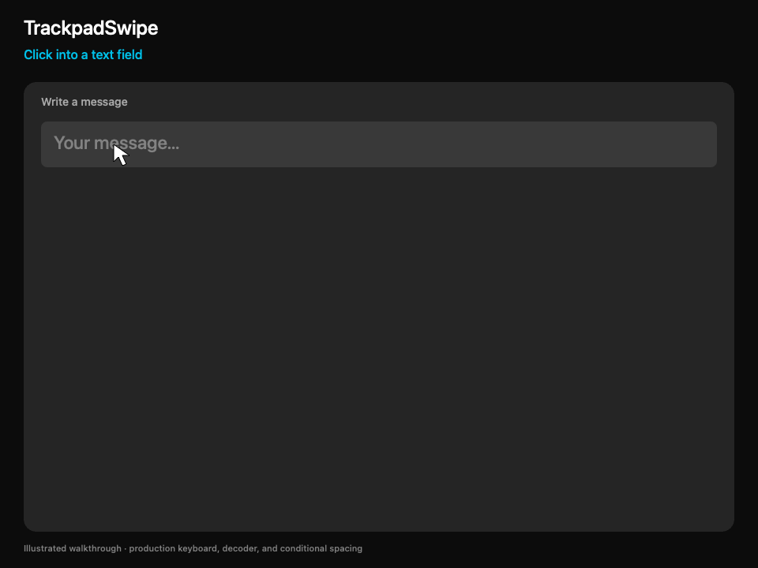

# TrackpadSwipe

A floating swipe keyboard for your Mac’s trackpad, with live word suggestions.



*Illustrated demo using the app’s keyboard, decoder, and spacing logic.*

## Install

Requires **macOS 15+**, Xcode Command Line Tools, Python 3, and OpenSSL.

```sh
git clone https://github.com/abwagner/TrackpadSwipe.git
cd TrackpadSwipe
native/setup-signing.sh
native/build.sh
```

Open `~/Applications/TrackpadType.app` and enable **TrackpadSwipe** in System Settings → Privacy & Security → Accessibility. See the [illustrated setup guide](docs/INSTALL.md) for packaging, permissions, and Settings.

## Use

1. Focus a text field, then **rest three fingers and physically click** to open the keyboard beside the cursor.
2. Click the starting letter, trace a word, then click again to enter it. Click another suggestion to correct it.
3. Press **Esc** or three-finger click to close.

**Fn** opens numbers/punctuation; **ABC** returns to letters. **⌫** deletes the previous word or selected text. Swipe contractions such as `don't` using their letters.

Spaces go **before** words only when needed: none for the first word or after a hyphen or whitespace. No trailing space is added.

Settings controls keyboard size/location, sensitivity, suggestion fonts, cursor appearance, and activation. [Shortcuts and external triggers](native/README.md) are also supported.

Experimental: a stroke captures all pointing devices; editor and trackpad compatibility varies. [Privacy](docs/PRIVACY.md) · [Release status](docs/RELEASE_READINESS.md) · [Contributing](CONTRIBUTING.md) · [Security](SECURITY.md)

Based on [SwipeType](https://github.com/ZimengXiong/swipeType). Code: [MIT](LICENSE). wordfreq-derived data: CC BY-SA 4.0. [Attribution and notices](THIRD_PARTY_NOTICES.md).
