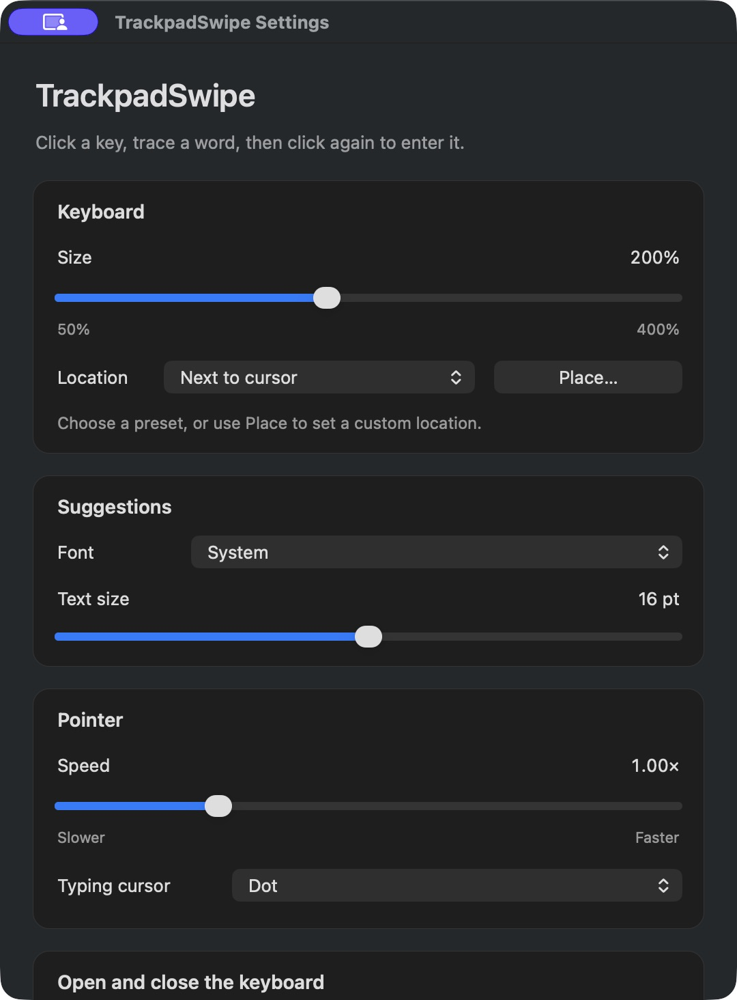
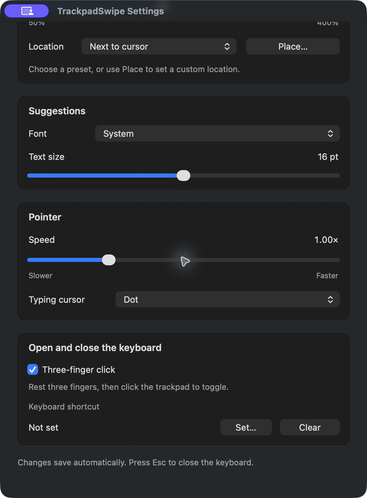

# Install and set up TrackpadSwipe

TrackpadSwipe is a menu-bar app for macOS 15 or later. Distribution packages contain both Apple silicon and Intel executables; hardware testing so far covers an Apple silicon Mac with its built-in trackpad. It is distributed directly, outside the Mac App Store.

## 1. Install the app

A public download location has not been announced. Binaries will not be distributed through GitHub. Package files built locally are in `native/build/dist/`.

- **DMG:** open the disk image, drag **TrackpadSwipe.app** onto **Applications**, then eject the disk image.
- **ZIP:** extract it and move **TrackpadSwipe.app** to **Applications**.

Open the app from Applications. No installer service, system extension, login item, or administrator helper is installed. Use one copy of the app at a time. Command helpers prefer `/Applications/TrackpadSwipe.app`, then `~/Applications/TrackpadSwipe.app`, with the old development path as a fallback. If you used a development build named TrackpadType.app, quit it first; moving to a distribution build may require a fresh Accessibility grant because its location/signing identity differs.

A normal distribution release must be signed with Developer ID and notarized. A file explicitly named **UNNOTARIZED-preview** is a local testing build, not an Apple-verified release. If you intentionally test it and macOS blocks its first launch, Apple's documented path is System Settings → Privacy & Security → Open Anyway after attempting to open it. See [Apple's guidance](https://support.apple.com/en-us/102445). Do not disable Gatekeeper globally.

## 2. Allow Accessibility

TrackpadSwipe needs Accessibility to intercept the activation click, capture pointer movement during a word, and enter text into the selected editor.

1. Open TrackpadSwipe. If access is missing, click its keyboard or choose **Settings… → Allow…**.
2. In System Settings → Privacy & Security → Accessibility, add the installed **TrackpadSwipe.app** and enable its switch.
3. Return to TrackpadSwipe. It checks for the grant automatically.

The app never grants itself permissions. Keep the app in the same installed location across updates.

## 3. Customize Settings

Choose **Settings…** from the keyboard icon in the menu bar (or press Command+, while TrackpadSwipe is active).

- **Keyboard:** adjust size and location. Next to cursor is the default; Place… lets you save a custom position.
- **Suggestions:** choose System, Rounded, or Monospaced and a separate 8–24 point text size. Longer words get another line without reducing the font size.
- **Pointer:** adjust stroke sensitivity and choose Dot, Ring, Crosshair, or Hidden for the typing marker.
- **Open and close the keyboard:** enable three-finger click or set an optional shortcut. Rest three fingers on the trackpad, then physically click; touching alone does not open the keyboard.

If the built-in gesture conflicts with your macOS trackpad settings, disable it and use your shortcut or an external trigger such as `trackpadswipe://toggle`. App launch also opens the keyboard.

## 4. Type your first word

1. Click into an ordinary editable text field.
2. Rest three fingers on the trackpad and click to open the keyboard near the cursor. Lift those fingers.
3. Move to **H** and click once to start a word. Move through **E → L → O**; the decoder handles the repeated L in “hello.” Live suggestions update as you move.
4. Click again to enter the best match. Words get a leading space only when needed: none at the start of the field or after a hyphen or whitespace. There is no automatic trailing space. Live suggestions do not enter text by themselves.
5. Click an alternate suggestion immediately after insertion if needed. Safe replacement requires an editor that exposes text ranges and permits setting the selected text.
6. Three-finger click again or press Esc to close. Esc cancels an unfinished word.

The animation is an illustration rendered with the app's keyboard and decoder, not a recording of someone else's desktop. Live matching is approximate; the final click runs a full-word match before committing.

Click **Fn** for numbers and punctuation, then **ABC** to return. Symbols enter with one click. **⌫** deletes the previous word or selected text. Swipe contractions through their letters (for example D → O → N → T for “don't”); choose the apostrophized suggestion when needed.

## Troubleshooting and uninstalling

- **Gesture does nothing:** check Accessibility, the Three-finger click setting, and whether the built-in trackpad is available. A three-finger touch/tap without a physical click is deliberately ignored.
- **No text appears:** focus the destination editor before starting a word; password fields are excluded. The editor must expose an accessible text field. Codex and Telegram Desktop use typing events targeted to its process; other editors use Accessibility selected-text writes. Unsupported editors refuse insertion. Compatibility differs by editor.
- **Another mouse stops moving while tracing:** capture currently applies to all pointing devices until click-off or Esc.
- **Remove the app:** Quit from the menu, remove its Accessibility entry, and move the app from Applications to the Trash. Preferences and the local status file can optionally be removed from `~/Library/Preferences/com.andz.TrackpadType.plist` and `~/Library/Application Support/TrackpadType/`. Development signing credentials are separate; do not remove a keychain needed for future development updates.
